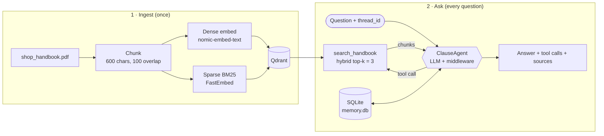

# Clause

Clause is a customer-support assistant for an online shop. It is an **agent** that answers questions by searching the shop handbook with a hybrid (dense + BM25) RAG tool. It runs fully locally with Ollama, and you can switch it to a hosted model such as Google Gemini.

Clause answers only from what the handbook says. Every reply comes with the searches it ran and the handbook pages it used. If the handbook doesn't cover a question, Clause says it doesn't know and points the customer to the support team.

## Highlights

- **Tool-calling agent.** Built with LangChain `create_agent`. The model decides when to call `search_handbook`, and it can search more than once for a two-part question.
- **Hybrid retrieval.** Qdrant combines dense embeddings (`nomic-embed-text`) with sparse BM25 vectors, so it catches both meaning ("send it back" ≈ "return policy") and exact terms (prices, day counts).
- **Grounded answers with sources.** Each response includes the tool calls and the source file, page and score of every chunk the agent read.
- **Conversation memory.** Conversations are checkpointed to SQLite and identified by a `thread_id`. Long histories are summarized automatically.
- **Guardrails through middleware.** The stack caps model and tool calls per question, trims old tool output and summarizes long conversations.
- **Versioned prompts.** System prompts live in `app/prompts/` as Markdown files, and you choose one with a setting.
- **Evals.** A golden test set measures retrieval hit rate, answer correctness, refusals and leaks of staff-only information.

## How it works



> Expand a step below for details and links to the code.

<details>
<summary><b>1. Load and chunk the handbook</b></summary>

`PyPDFLoader` reads the PDF page by page. `RecursiveCharacterTextSplitter` cuts it into chunks of about 600 characters with 100 characters of overlap. It prefers to split at paragraph and line breaks, so a sentence that answers a question is rarely cut in half.

Code: [`ingestion.py`](api/app/services/ingestion.py) · Settings: `RAG_DATA_PATH`, `RAG_CHUNK_SIZE`, `RAG_CHUNK_OVERLAP`
</details>

<details>
<summary><b>2. Embed twice and store in Qdrant</b></summary>

Each chunk gets two vectors, and both are stored in one Qdrant collection:

| Vector   | Model                                | Good at                                         |
|----------|--------------------------------------|-------------------------------------------------|
| `dense`  | `nomic-embed-text` (Ollama, 768-dim) | Meaning: "send it back" ≈ "return policy"       |
| `sparse` | BM25 (`Qdrant/bm25`, FastEmbed)      | Exact terms: prices, day counts, product names  |

Before the old collection is deleted, ingestion checks that the embedding model really returns `RAG_EMBED_DIM` dimensions, so a bad config can't wipe the index. By default Qdrant runs embedded on disk at `./vector_stores`. Set `RAG_QDRANT_URL` to use a server instead.

Code: [`ingestion.py`](api/app/services/ingestion.py), [`vectorstore.py`](api/app/rag/vectorstore.py)
</details>

<details>
<summary><b>3. The agent decides whether to search</b></summary>

`ClauseAgent` wraps a LangChain agent that has a single tool, `search_handbook`. The system prompt tells it to:

- search before answering questions about refunds, delivery, payments, warranty, exchanges, tracking, loyalty, privacy or support hours
- search once for each part of a two-part question
- reply to greetings and small talk without searching

Code: [`agent.py`](api/app/services/agent.py) · Prompt: [`support/system/v3.md`](api/app/prompts/support/system/v3.md)
</details>

<details>
<summary><b>4. Hybrid search tool</b></summary>

`search_handbook` embeds the query both ways, and Qdrant fuses the dense and BM25 results into the top `RAG_TOP_K` chunks. The chunk text goes to the model. The source metadata (file, page, score) is returned separately as a tool artifact, so the API can report sources without the model having to repeat them.

Code: [`handbook.py`](api/app/tools/knowledge/handbook.py) · Setting: `RAG_TOP_K`
</details>

<details>
<summary><b>5. Middleware and memory</b></summary>

Every question runs through this middleware stack:

| Middleware                  | What it does                                                        |
|-----------------------------|---------------------------------------------------------------------|
| `ModelCallLimitMiddleware`  | Stops after `RAG_MAX_MODEL_CALLS` model calls per question          |
| `ToolCallLimitMiddleware`   | Allows at most `RAG_MAX_TOOL_CALLS` tool calls per question         |
| `ContextEditingMiddleware`  | Clears old tool results once the context grows, keeping the last 2  |
| `SummarizationMiddleware`   | Summarizes old messages once the history reaches `RAG_SUMMARY_TRIGGER_TOKENS` tokens |

Conversation state is saved by a LangGraph `SqliteSaver` checkpointer in `memory.db`. Each conversation is keyed by its `thread_id`.

Code: [`stacks.py`](api/app/middleware/stacks.py)
</details>

<details>
<summary><b>6. Grounded answer with sources</b></summary>

The prompt tells the model to use only facts from the search results, copy numbers exactly, keep answers to one or two sentences and never reveal internal or staff-only information. When the handbook doesn't cover a question, it replies:

> I don't know. Our support team can help on live chat or at help@shop.com.

A response looks like this (example values):

```json
{
  "answer": "You can ask for a refund within 14 days of delivery.",
  "thread_id": "3f6c1e2a-…",
  "tool_calls": [{ "name": "search_handbook", "args": { "query": "refund window" } }],
  "sources": [{ "source": "data/shop_handbook.pdf", "page": 0, "score": 0.82 }],
  "searches": ["refund window"]
}
```
</details>

<details>
<summary><b>7. Evals</b></summary>

A golden test set ([`golden.jsonl`](api/evals/golden.jsonl)) runs every question through `ClauseAgent` and grades the answers for retrieval hit rate, answer correctness, refusals and leaks of staff-only information. Each run is saved with its config to `api/evals/results/`, so you can compare runs.

Code: [`run.py`](api/evals/run.py)
</details>

## Tech stack

| Layer         | Technology                                                    |
|---------------|---------------------------------------------------------------|
| API           | FastAPI                                                       |
| Agent         | LangChain `create_agent` + agent middleware                   |
| Memory        | LangGraph `SqliteSaver` checkpointer                          |
| Chat model    | Ollama (local) or Google Gemini through `init_chat_model`     |
| Embeddings    | Ollama `nomic-embed-text` (dense) + FastEmbed BM25 (sparse)   |
| Vector store  | Qdrant (embedded on disk, or a server)                        |
| Validation    | Pydantic v2 + pydantic-settings                               |
| Tooling       | Python 3.13, uv                                               |

## Repository layout

| Folder        | What it holds                                                          |
|---------------|------------------------------------------------------------------------|
| `api/`        | FastAPI backend: agent, RAG tool, middleware, prompts, evals and CLI   |
| `web/`        | Frontend (coming soon)                                                 |
| `notebooks/`  | Step-by-step learning notebooks (local only, not tracked)              |
| `playground/` | Standalone RAG experiments (local only, not tracked)                   |

## Quick start

**Prerequisites:** Python 3.13+, [uv](https://docs.astral.sh/uv/) and [Ollama](https://ollama.com/).

```bash
# 1. Pull the local models
ollama pull qwen3.5:4b
ollama pull nomic-embed-text

# 2. Install and configure
cd api
uv sync
cp .env.example .env        # pick a chat model, then set RAG_CHAT_API_KEY if it is a hosted one

# 3. Build the vector store
uv run python -m app.services.ingestion

# 4. Start the API
uv run fastapi dev app/main.py
```

Open http://127.0.0.1:8000/docs and try `POST /ask`, or chat from the terminal with `uv run python -m app.cli`.

> **Note:** embedded Qdrant can be opened by only one process at a time. Stop the API before you run the CLI, ingestion or evals.

See [`api/README.md`](api/README.md) for the endpoint reference, configuration, evals and the project structure.
